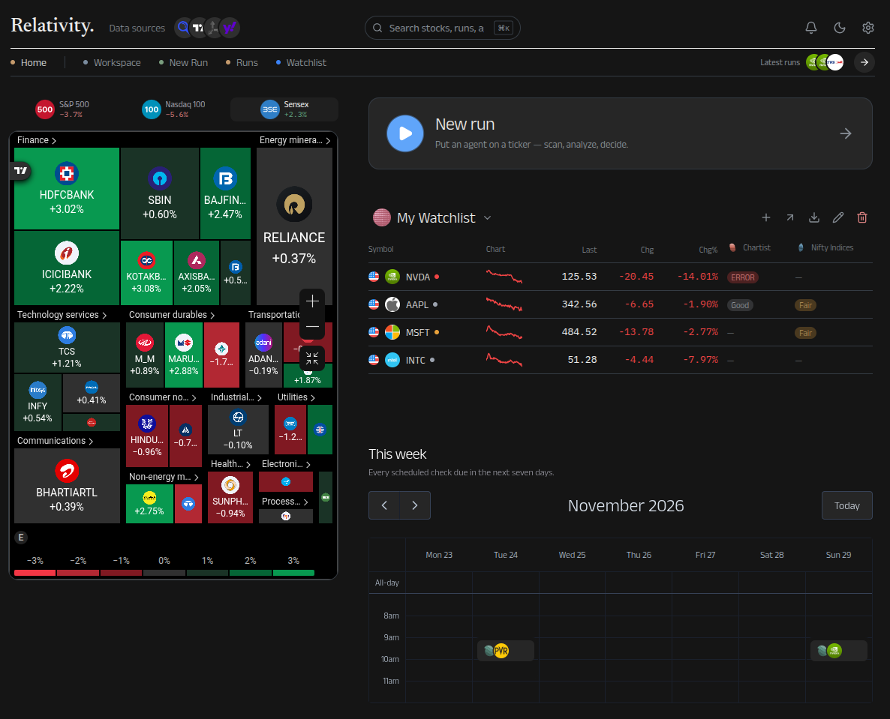
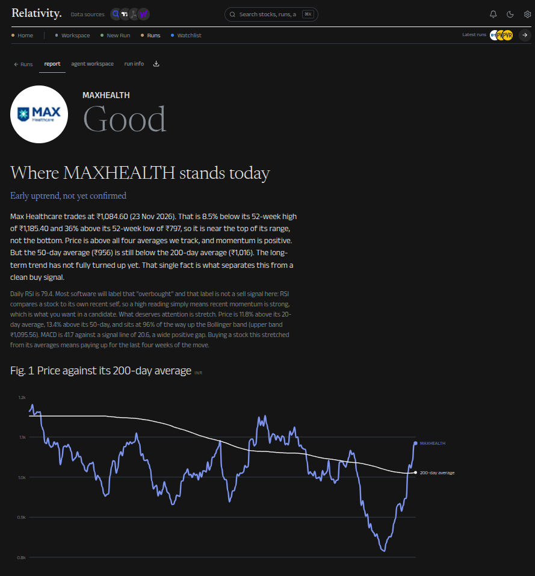
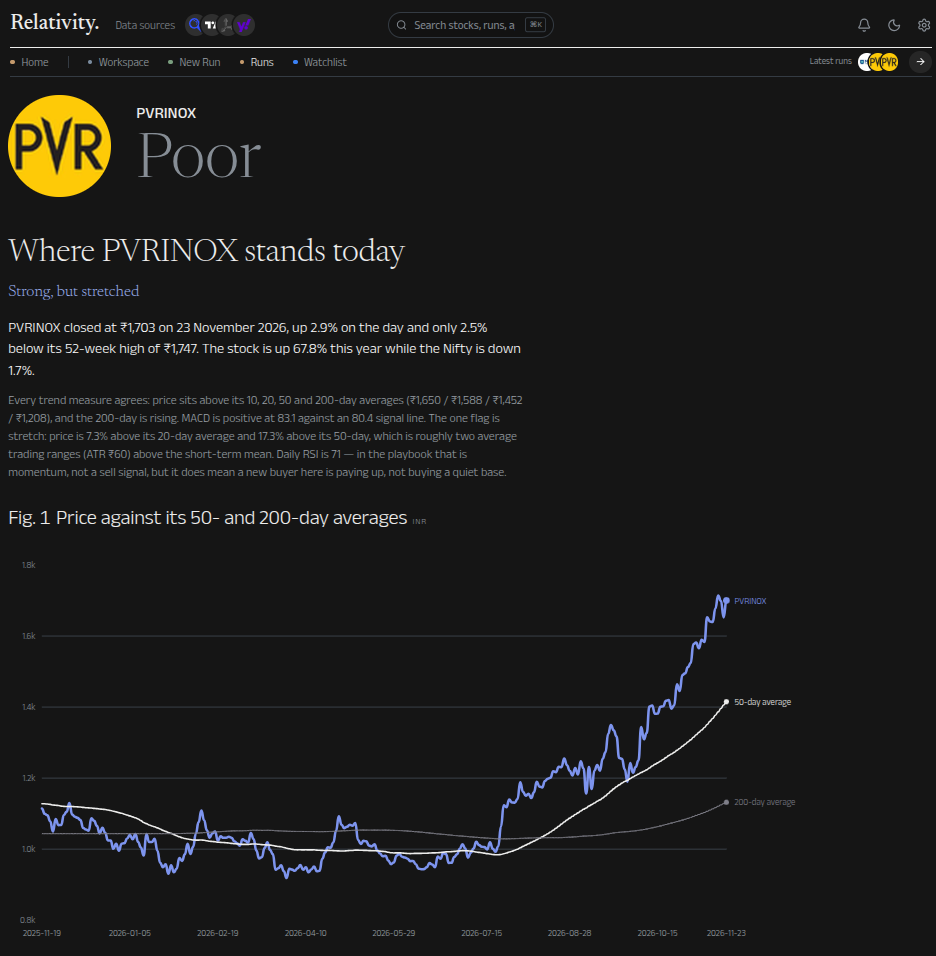
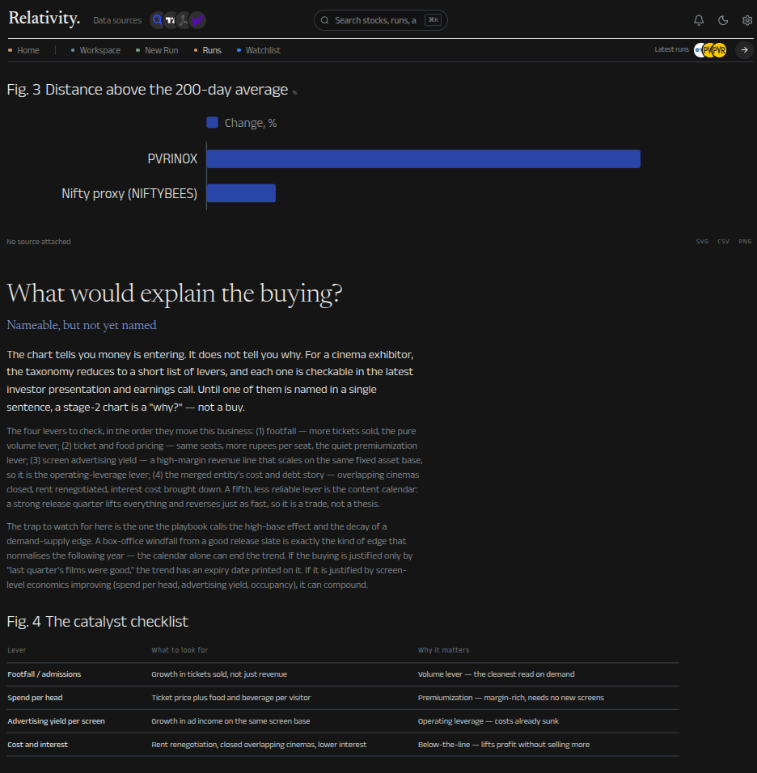
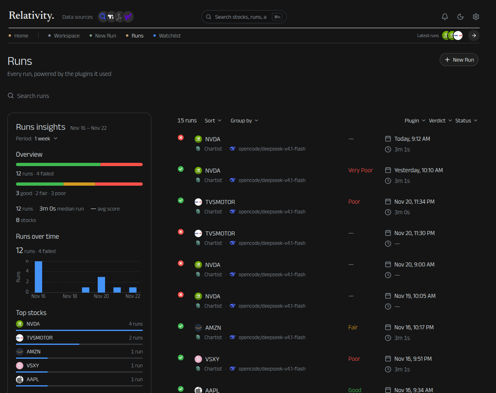
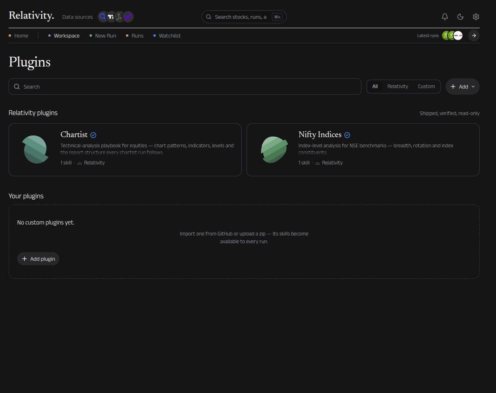

<a id="readme-top"></a>

<p align="center">
  
</p>

<h3 align="center">An agent-first stock market research and monitoring platform</h3>

<div align="center">

  [](https://twitter.com/intent/tweet?text=%F0%9F%93%A2%20An%20agent-first%20stock%20market%20research%20and%20monitoring%20platform&url=https://github.com/relativityAI/relativity-markets)
  []()
  [](https://github.com/relativityAI/relativity-markets/issues)
  [](https://github.com/relativityAI/relativity-markets/pulls)
  [](https://github.com/relativityAI/relativity-markets/blob/main/LICENSE)

</div>

<div align="center">
  Built by <a href="https://github.com/avishkarArjan/"></a>
</div>

## App screenshots

<p align="center">
  
</p>
<p align="center"><sub>Home — market heatmap, watchlist and this week's scheduled runs</sub></p>

## Agent Report Screenshots

<table align="center">
  <tr>
    <td align="center" width="50%">
      
      <br><sub>Verdict and thesis — MAXHEALTH scored "Good"</sub>
    </td>
    <td align="center" width="50%">
      
      <br><sub>Charts and checklists — distance above the 200-day average, catalyst checklist</sub>
    </td>
  </tr>
  <tr>
    <td align="center" width="50%">
      
      <br><sub>PVRINOX scored "Poor" — price against its 50- and 200-day averages</sub>
    </td>
    <td align="center" width="50%">
      
      <br><sub>Relative strength vs peers and the index, plus the entry plan</sub>
    </td>
  </tr>
</table>

## Table of Contents

1. [App screenshots](#app-screenshots)
2. [Agent Report Screenshots](#agent-report-screenshots)
3. [Prerequisites](#prerequisites)
4. [Install](#install)
5. [Usage](#usage)
6. [Cleanup](#cleanup)
7. [Architecture](#architecture)
8. [Top contributors:](#top-contributors)
9. [License](#license)


## Prerequisites

- **Git** — required
- **Docker** — required (app + web search run on it). On Linux, `install.sh` installs Docker, Compose and `curl` via the system package manager if they are missing (sudo required). Set `RELATIVITY_SKIP_PACKAGE_INSTALL=1` to opt out.
- **Windows:** [Git Bash](https://git-scm.com/download/win)

## Install

```bash
git clone https://github.com/relativityAI/relativity-markets.git && cd relativity-markets && bash install.sh
```

`install.sh` is the single entry point: it detects the platform and delegates to `scripts/install-linux.sh` (Linux/macOS) or `scripts/install-windows.sh` (Windows/Git Bash). Shared logic lives in `scripts/install-common.sh`.

Re-running `install.sh` is safe — it skips packages and PATH setup that are already in place.

**First visit**

No sign-up. Local user created automatically. Open **Settings** → paste LLM API keys (OpenAI, Gemini, Anthropic, ...). Encrypted, stored locally in `services/data/relativity.db`.

## Usage

```bash
relativity
```

Opens http://127.0.0.1:8501. Stop: `Ctrl+C`. Every run pulls the latest app image, so you always get the newest version — no `git pull` needed.

- Windows: install via Git Bash. Works in cmd, PowerShell, Git Bash.
- Closing the terminal (or Ctrl+C) stops the containers — nothing left running.
- Dev mode: `npm install && npm run dev` → http://localhost:5173

Pages:

- **`/new-run`** — start an analysis run
- **`/runs`** — saved runs
- **`/plugins/:id`** — plugin detail (overview + files)
- **`/my-workspace`** — plugins, active runs, alerts
- **`/settings`** — API keys (encrypted)

### Screenshots of the pages

<table align="center">
  <tr>
    <td align="center" width="50%">
      
      <br><sub><code>/runs</code> — insights, verdicts, sort and group filters</sub>
    </td>
    <td align="center" width="50%">
      
      <br><sub>Plugin library — shipped, verified plugins and your own</sub>
    </td>
  </tr>
  <tr>
    <td align="center" width="50%">
      
      <br><sub><code>/new-run</code> — schedule a run, with scheduled agents on the calendar</sub>
    </td>
    <td align="center"></td>
  </tr>
</table>

CLI (from `services/`, needs `npm run searxng` + `OPENCODE_API_KEY`):

```bash
npm run cli -- --symbol AAPL --model opencode/deepseek-v4.1-flash --max-steps 20 --skill chartist-playbook
```

## Cleanup

```bash
bash cleanup.sh
```

Like `install.sh`, this is a single entry point that delegates to `scripts/cleanup-linux.sh` or `scripts/cleanup-windows.sh`. It removes only the `relativity` command, the PATH entries the installer added, this checkout's Docker containers, and the two images this project owns. Local data (`services/data`), system packages, Docker volumes, third-party images and other projects are left untouched.

<p align="right">(<a href="#readme-top">back to top</a>)</p>


## Architecture

<p align="center">
  
</p>

<p align="right">(<a href="#readme-top">back to top</a>)</p>


### Top contributors:

<a href="https://github.com/relativityAI/relativity-markets/graphs/contributors">
  
</a>

<p align="right">(<a href="#readme-top">back to top</a>)</p>


## License

Distributed under the MIT License. See [`LICENSE`](LICENSE) for details.

<p align="right">(<a href="#readme-top">back to top</a>)</p>
