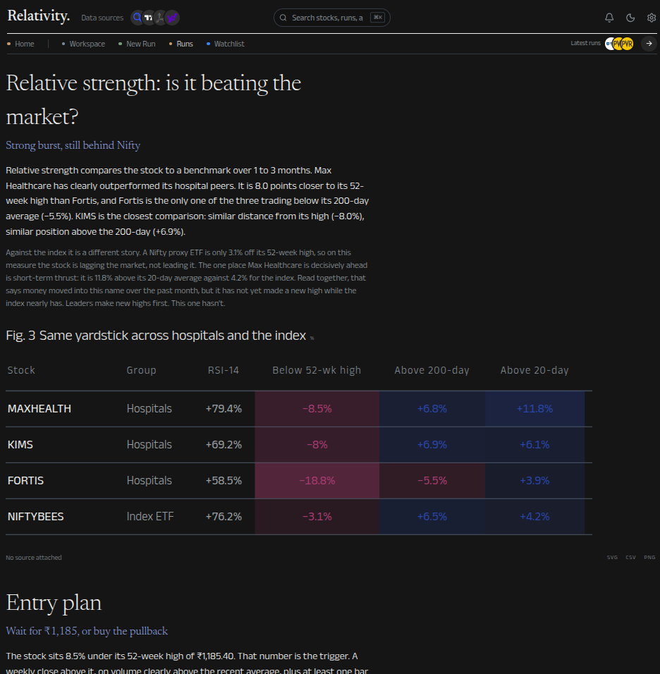
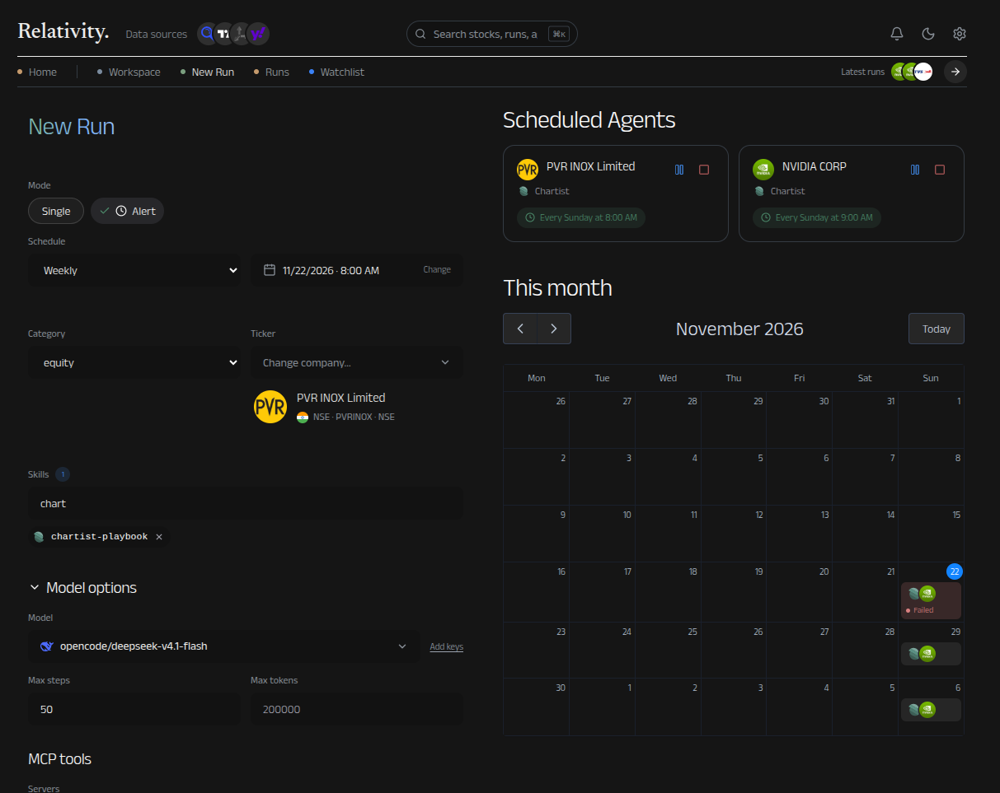

<a id="readme-top"></a>

<p align="center">
  
</p>

<h3 align="center">An agent-first stock market research and monitoring platform</h3>

<div align="center">

  [](https://twitter.com/intent/tweet?text=%F0%9F%93%A2%20An%20agent-first%20stock%20market%20research%20and%20monitoring%20platform&url=https://github.com/relativityAI/relativity-markets)
  []()
  [](https://github.com/relativityAI/relativity-markets/issues)
  [](https://github.com/relativityAI/relativity-markets/pulls)
  [](https://github.com/relativityAI/relativity-markets/blob/main/LICENSE)

</div>

<div align="center">
  Built by <a href="https://github.com/avishkarArjan/"></a>
</div>

## App screenshots

<p align="center">
  
</p>
<p align="center"><sub>Home — market heatmap, watchlist and this week's scheduled runs</sub></p>

## Agent Report Screenshots

<table align="center">
  <tr>
    <td align="center" width="50%">
      
      <br><sub>Verdict and thesis — MAXHEALTH scored "Good"</sub>
    </td>
    <td align="center" width="50%">
      
      <br><sub>Charts and checklists — distance above the 200-day average, catalyst checklist</sub>
    </td>
  </tr>
  <tr>
    <td align="center" width="50%">
      
      <br><sub>PVRINOX scored "Poor" — price against its 50- and 200-day averages</sub>
    </td>
    <td align="center" width="50%">
      
      <br><sub>Relative strength vs peers and the index, plus the entry plan</sub>
    </td>
  </tr>
</table>

## Table of Contents

1. [Prerequisites](#prerequisites)
2. [Install](#install)
3. [Usage](#usage)
4. [Cleanup](#cleanup)
5. [Architecture](#architecture)
6. [License](#license)


## Prerequisites

- **Docker** — required
  - Linux: the installer can install it for you (sudo required)
  - Opt out with `RELATIVITY_SKIP_PACKAGE_INSTALL=1`
- **Git** — only for development or plain-Docker option 1

## Install

No clone, no Git — one line per platform:

```bash
# macOS / Linux
curl -fsSL https://raw.githubusercontent.com/relativityAI/relativity-markets/main/install.sh | sh
```

```powershell
# Windows (PowerShell — no Git Bash needed)
irm https://raw.githubusercontent.com/relativityAI/relativity-markets/main/install.ps1 | iex
```

What the installer does:

- Checks Docker is running (Linux: installs missing packages for you)
- Downloads the stack to `~/.local/share/relativity` (Windows: `%LOCALAPPDATA%\relativity`)
- Puts the `relativity` command on your PATH
- Safe to re-run — skips whatever is already in place
- From a checkout: `bash install.sh` (Windows: `powershell -File install.ps1`)

**First visit**

- No sign-up — a local user is created automatically
- Open **Settings** → paste your LLM API keys (OpenAI, Gemini, Anthropic, ...)
- Keys are encrypted and stored locally in `services/data/relativity.db`

### Run it with plain Docker (no installer)

**Option 1 — with a clone** (full repo, best if you want to read or change the code):

```bash
git clone https://github.com/relativityAI/relativity-markets.git
cd relativity-markets

mkdir -p services/data     # pre-create it, or Docker makes it root-owned
docker compose up -d       # → http://127.0.0.1:8501
docker compose down        # stop
```

**Option 2 — without cloning** (just the app, one file, no Git):

```bash
mkdir -p my-relativity && cd my-relativity
mkdir -p services/data     # same reason: Docker would create it root-owned

curl -fsSL https://raw.githubusercontent.com/relativityAI/relativity-markets/main/docker-compose.yml -o docker-compose.yml
docker compose up -d       # → http://127.0.0.1:8501
docker compose down        # stop
```

Notes:

- Windows PowerShell: use `curl.exe` instead of `curl`
- Option 2: data lands in `services/data` next to the compose file

## Usage

```bash
relativity
```

- Opens http://127.0.0.1:8501
- Runs in the background — stop with `relativity stop`
- Pulls the newest app image every run — no `git pull` needed
- Works in cmd, PowerShell, Git Bash and any Unix shell
- Dev mode: `npm install && npm run dev` → http://localhost:5173

> **Used the raw Docker options in Install?** The `relativity` command does not exist there. Start with `docker compose up -d`, stop with `docker compose down`.

Pages:

- **`/new-run`** — start an analysis run
- **`/runs`** — saved runs
- **`/plugins/:id`** — plugin detail (overview + files)
- **`/my-workspace`** — plugins, active runs, alerts
- **`/settings`** — API keys (encrypted)

### Screenshots of the pages

<table align="center">
  <tr>
    <td align="center" width="50%">
      
      <br><sub><code>/runs</code> — insights, verdicts, sort and group filters</sub>
    </td>
    <td align="center" width="50%">
      
      <br><sub>Plugin library — shipped, verified plugins and your own</sub>
    </td>
  </tr>
  <tr>
    <td align="center" width="50%">
      
      <br><sub><code>/new-run</code> — schedule a run, with scheduled agents on the calendar</sub>
    </td>
    <td align="center"></td>
  </tr>
</table>

CLI (from `services/`, needs `npm run searxng` + `OPENCODE_API_KEY`):

```bash
npm run cli -- --symbol AAPL --model opencode/deepseek-v4.1-flash --max-steps 20 --skill chartist-playbook
```

## Cleanup

```bash
relativity uninstall
```

- Stops the stack, removes the `relativity` command and the installer's PATH entries
- Deletes the downloaded files — **keeps your data** (`services/data`)
- From a checkout: only stops the stack and removes the command
- Never touches system packages, volumes, third-party images or other projects

Reclaim disk space:

```bash
docker rmi ghcr.io/relativityai/relativity-markets ghcr.io/relativityai/relativity-searxng ghcr.io/relativityai/tradingview-mcp
```

**Raw Docker users:** `docker compose down` stops it; delete your folder to remove it.

<p align="right">(<a href="#readme-top">back to top</a>)</p>


## Architecture

<p align="center">
  
</p>

<p align="right">(<a href="#readme-top">back to top</a>)</p>


### Top contributors:

<a href="https://github.com/relativityAI/relativity-markets/graphs/contributors">
  
</a>

<p align="right">(<a href="#readme-top">back to top</a>)</p>


## License

Distributed under the MIT License. See [`LICENSE`](LICENSE) for details.

<p align="right">(<a href="#readme-top">back to top</a>)</p>
